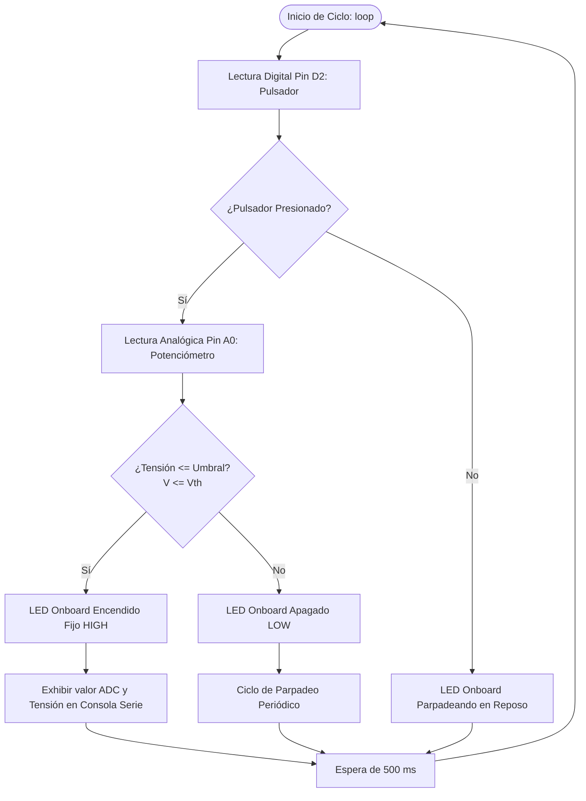
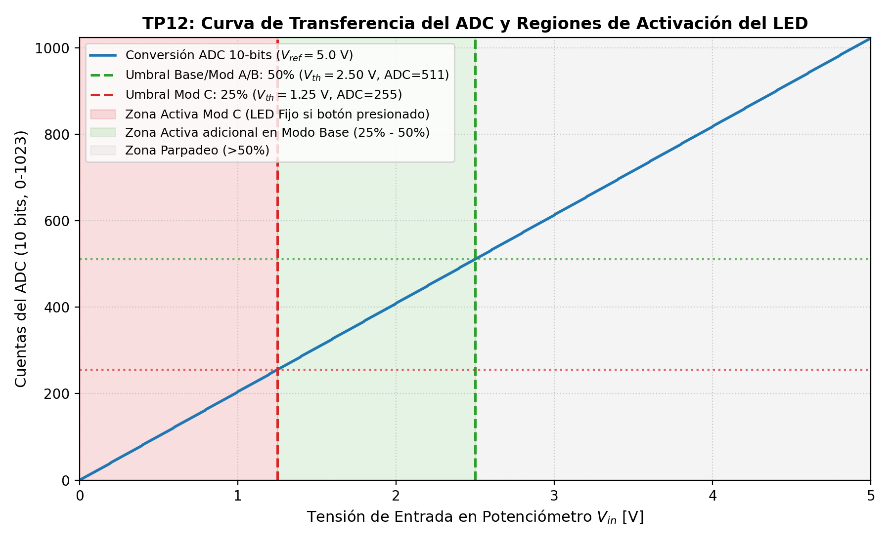
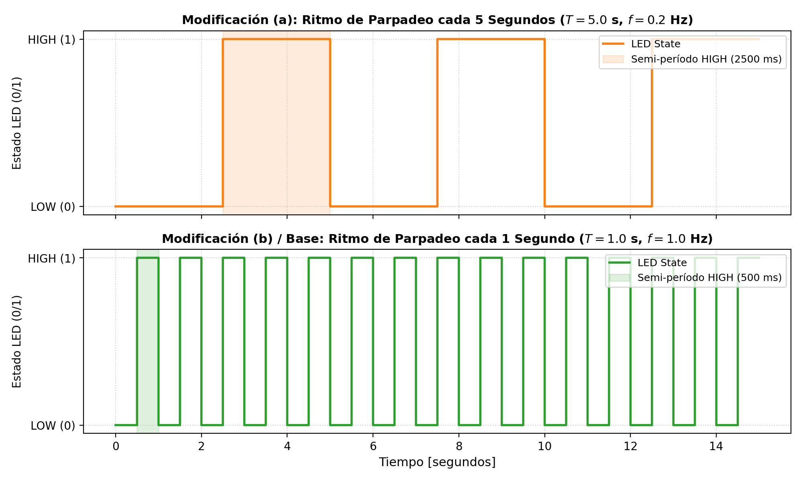

# TP12: Sistemas Embebidos - Plataforma Arduino Uno

**Asignatura:** Ingeniería de Software II  
**Docente:** Dr. Pedro E. Colla  
**Institución:** Facultad de Ciencia y Tecnología (FCyT) - Universidad Autónoma de Entre Ríos (UADER)  
**Alumno:** Jesús Arévalo  
**Ubicación de Código y Documentación:** `src/tp12/`  

---

## Tabla de Contenidos

1. [Resumen Ejecutivo y Objetivos](#1-resumen-ejecutivo-y-objetivos)
2. [Marco Teórico: Arquitectura Embebida y Conversión A/D](#2-marco-teórico-arquitectura-embebida-y-conversión-ad)
3. [Auditoría e Inspección del Firmware Original](#3-auditoría-e-inspección-del-firmware-original)
4. [Diseño y Esquema del Circuito](#4-diseño-y-esquema-del-circuito)
5. [Implementación del Firmware Base](#5-implementación-del-firmware-base)
6. [Resolución de las Modificaciones Solicitadas](#6-resolución-de-las-modificaciones-solicitadas)
   - [6.1. Modificación (a): Ritmo de Parpadeo cada 5 Segundos](#61-modificación-a-ritmo-de-parpadeo-cada-5-segundos)
   - [6.2. Modificación (b): Ritmo de Parpadeo cada 1 Segundo](#62-modificación-b-ritmo-de-parpadeo-cada-1-segundo)
   - [6.3. Modificación (c): Umbral de Activación al 25% de la Tensión](#63-modificación-c-umbral-de-activación-al-25-de-la-tensión)
7. [Simulación en Python y Suite de Pruebas Unitarias](#7-simulación-en-python-y-suite-de-pruebas-unitarias)
8. [Guía Paso a Paso para TinkerCad y Arduino IDE](#8-guía-paso-a-paso-para-tinkercad-y-arduino-ide)
9. [Conclusiones](#9-conclusiones)

---

## 1. Resumen Ejecutivo y Objetivos

El presente trabajo práctico aborda el diseño, análisis estático, depuración, refactorización y verificación empírica de un sistema embebido en tiempo real implementado sobre la plataforma **Arduino Uno** (con microcontrolador **Microchip/Atmel ATmega328P**). 

El sistema realiza el censado concurrente de una señal binaria mediante un **pulsador mecánico (entrada digital en D2)** y una magnitud analógica continua mediante un **potenciómetro divisor de tensión de 10 kΩ (entrada analógica en A0)**. En función del estado del pulsador y de la magnitud de la tensión analógica respecto de un umbral predefinido, el firmware modula el estado del **LED onboard (pin digital 13)** emitiendo a su vez registros de telemetría a través del canal serie UART (9600 bps).



---

## 2. Marco Teórico: Arquitectura Embebida y Conversión A/D

### 2.1. Conversor Analógico-Digital (ADC) de 10 bits

El microcontrolador ATmega328P incorpora un ADC de aproximaciones sucesivas (*Successive Approximation Register - SAR*) de 10 bits de resolución. Con una tensión de referencia analógica seleccionada de $V_{ref} = 5.0\text{ V}$, el espacio analógico continuo $[0.0\text{ V}, 5.0\text{ V}]$ se proyecta sobre $2^{10} = 1024$ intervalos de cuantización:

$$\text{Rango Discreto} = \{0, 1, 2, \dots, 1023\}$$

$$\text{Resolución por LSB} = \Delta V = \frac{V_{ref}}{2^{10} - 1} = \frac{5.0\text{ V}}{1023} \approx 4.8876\text{ mV/cuentas}$$

Para cualquier tensión de entrada $V_{in} \in [0, 5\text{V}]$ introducida por el cursor del potenciómetro, el valor entero devuelto por la función `analogRead(A0)` responde a la función escalón:

$$\text{ADC}_{val} = \left\lfloor \frac{V_{in}}{V_{ref}} \times 1023 \right\rfloor$$

$$\hat{V}_{in} = \frac{\text{ADC}_{val} \times 5.0\text{ V}}{1023}$$

### 2.2. Cálculo Teórico de los Umbrales de Disparo

- **Umbral Base (50% de la tensión de la fuente):**
  $$V_{th, 50\%} = 0.50 \times 5.0\text{ V} = 2.50\text{ V}$$
  $$\text{ADC}_{th, 50\%} = \lfloor 0.50 \times 1023 \rfloor = 511\text{ cuentas}$$

- **Umbral Modificación (c) (25% de la tensión de la fuente):**
  $$V_{th, 25\%} = 0.25 \times 5.0\text{ V} = 1.25\text{ V}$$
  $$\text{ADC}_{th, 25\%} = \lfloor 0.25 \times 1023 \rfloor = 255\text{ cuentas}$$

---

## 3. Auditoría e Inspección del Firmware Original

Al inspeccionar el código provisto como plantilla (`is2_taller_sistemas_embebidos.ino`):

```cpp
// Código original provisto:
const int D2=2;
void setup() {
  pinMode(LED_BUILTIN, OUTPUT);
  pinMode(A0,INPUT);
  pinMode(2,INPUT);
  Serial.begin(9600);
  digitalWrite(3,HIGH);
}
void loop() {
  int pin2=digitalRead(2);
  if (pin2 == 0) {
      digitalWrite(LED_BUILTIN,HIGH);
      int a=analogRead(2);
      Serial.println(a);
  } else {
      digitalWrite(LED_BUILTIN,LOW);
      delay(500);
      digitalWrite(LED_BUILTIN,HIGH);
  }
  delay(500);
}
```

Se identificaron los siguientes defectos críticos de software embebido:

1. **Lectura de canal analógico incorrecto (`DEF-01`):** `analogRead(2)` referencia la entrada analógica A2. Sin embargo, en el circuito de TinkerCad el cursor del potenciómetro está conectado al pin `A0` (declarado formalmente en `pinMode(A0, INPUT)`). Solución: invocar `analogRead(A0)`.
2. **Ausencia del bloque de decisión por umbral de tensión (`DEF-02`):** La consigna establece que el LED permanecerá encendido fijo **únicamente cuando la tensión sea la mitad o menor que la de la fuente**. En el código provisto, el LED se encendía siempre que se pulsara el botón, independientemente del valor analógico. Solución: incorporar la cláusula de decisión `if (valorADC <= UMBRAL_ADC)`.
3. **Comando residual espurio (`DEF-03`):** La instrucción `digitalWrite(3, HIGH);` escribe en un pin D3 que nunca fue configurado como `OUTPUT` y que no interviene en el circuito. Solución: eliminar dicha línea.
4. **Acoplamiento de polaridad del pulsador (`DEF-04`):** El código asume lógica activa-baja (`pin2 == 0`). En la conexión habitual de TinkerCad se utiliza resistencia pull-down externa (activo en `HIGH`). Solución: desacoplar mediante constantes de configuración (`BUTTON_PRESSED`).

---

## 4. Diseño y Esquema del Circuito

### 4.1. Tabla de Asignación de Pines (Pinout)

| Componente | Terminal | Pin Arduino Uno | Modo / Función | Notas |
| :--- | :--- | :--- | :--- | :--- |
| **Potenciómetro (10 kΩ)** | Terminal 1 | `5V` (Riel +) | Alimentación | Extremo superior divisor resistivo |
| **Potenciómetro (10 kΩ)** | Terminal 2 (Cursor/Wiper) | `A0` | Entrada Analógica (`INPUT`) | Tensión variable $0.0\text{ V} \dots 5.0\text{ V}$ |
| **Potenciómetro (10 kΩ)** | Terminal 3 | `GND` (Riel -) | Referencia 0V | Extremo inferior divisor resistivo |
| **Pulsador (Push Button)** | Terminal 1a | `5V` (Riel +) | Alimentación | Conmutación de señal |
| **Pulsador (Push Button)** | Terminal 2a | `D2` | Entrada Digital (`INPUT`) | Conectado al nodo de censado |
| **Resistor Pull-down (10 kΩ)**| Terminal 1 | `D2` (y pulsador) | Polarización | Asegura estado LOW en reposo |
| **Resistor Pull-down (10 kΩ)**| Terminal 2 | `GND` (Riel -) | Tierra | Deriva fugas a GND |
| **LED Onboard** | Ánodo / Cátodo | `D13` (`LED_BUILTIN`)| Salida Digital (`OUTPUT`)| Indicador óptico de estado |

### 4.2. Diagrama Eléctrico Esquemático

```
       +5V (Arduino)
        │
        ├──[ Terminal 1 ]──────────────────────────────┐
        │                                              │
     [Potenciómetro 10k]                         [Pulsador Push]
        │                                              │
        ├──[ Cursor / Wiper ]──> Pin A0                ├───> Pin D2 (Arduino)
        │                                              │
        ├──[ Terminal 3 ]──┐                     [Resistor 10k Pull-down]
        │                  │                           │
       GND                GND                         GND
```

---

## 5. Implementación del Firmware Base

El archivo [firmware_base.ino](file:///c:/Users/Usuario/Desktop/is2_arevalo/src/tp12/firmware_base.ino) resuelve integralmente la especificación original de la página 1:

```cpp
//*------------------------------------------------------------------
//* Firmware Base: Umbral al 50% de Vcc y parpadeo de 1 segundo
//*------------------------------------------------------------------
const int PIN_BUTTON = 2;          // Pulsador en pin digital 2
const int PIN_POT    = A0;         // Potenciómetro en pin analógico A0
const int PIN_LED    = LED_BUILTIN;// LED onboard (pin digital 13)

const int UMBRAL_ADC = 511;        // 50% de 1023 (aprox 2.5V sobre 5V de Vcc)
const int BUTTON_PRESSED = HIGH;   // Lógica con resistencia pull-down
const unsigned long DELAY_500MS = 500;

void setup() {
  pinMode(PIN_LED, OUTPUT);
  pinMode(PIN_POT, INPUT);
  pinMode(PIN_BUTTON, INPUT);

  Serial.begin(9600);
  Serial.println(F("--- TP12: Firmware Base (Umbral 50%, Parpadeo 1s) ---"));
}

void loop() {
  int estadoBoton = digitalRead(PIN_BUTTON);

  if (estadoBoton == BUTTON_PRESSED) {
    int valorADC = analogRead(PIN_POT);
    float tension = (valorADC * 5.0) / 1023.0;

    if (valorADC <= UMBRAL_ADC) {
      digitalWrite(PIN_LED, HIGH); // LED permanente encendido
      Serial.print(F("Boton Presionado | ADC: "));
      Serial.print(valorADC);
      Serial.print(F(" | Tension: "));
      Serial.print(tension, 2);
      Serial.println(F(" V (<= 50%) -> LED ON PERMANENTE"));
    } else {
      Serial.print(F("Boton Presionado | ADC: "));
      Serial.print(valorADC);
      Serial.print(F(" | Tension: "));
      Serial.print(tension, 2);
      Serial.println(F(" V (> 50%) -> LED PARPADEANDO"));

      digitalWrite(PIN_LED, LOW);
      delay(DELAY_500MS);
      digitalWrite(PIN_LED, HIGH);
      delay(DELAY_500MS);
      digitalWrite(PIN_LED, LOW);
    }
  } else {
    // En reposo (sin presionar): LED parpadea periódicamente
    digitalWrite(PIN_LED, LOW);
    delay(DELAY_500MS);
    digitalWrite(PIN_LED, HIGH);
    delay(DELAY_500MS);
    digitalWrite(PIN_LED, LOW);
  }

  // Espera de 500 ms al finalizar la lectura para repetir el ciclo
  delay(DELAY_500MS);
}
```

---

## 6. Resolución de las Modificaciones Solicitadas

De acuerdo a las consignas de la página 2 del documento de especificación:

### 6.1. Modificación (a): Ritmo de Parpadeo cada 5 Segundos
> *"a. Modifique el programa para que el ritmo de parpadeo sea una vez cada 5 segundos, repita el procedimiento de compilación, carga en la placa y verificación anterior."*

- **Análisis Temporal:** Para obtener una frecuencia de parpadeo de una conmutación completa cada 5 segundos ($T = 5.0\text{ s}$, $f = 0.2\text{ Hz}$), el ciclo de trabajo simétrico requiere un semiperíodo de 2500 ms en nivel bajo (`LOW`) y 2500 ms en nivel alto (`HIGH`).
- **Implementación:** Archivo [firmware_mod_a_5s.ino](file:///c:/Users/Usuario/Desktop/is2_arevalo/src/tp12/firmware_mod_a_5s.ino).
  ```cpp
  const unsigned long TIEMPO_SEMI_PERIODO = 2500; // 2500ms OFF + 2500ms ON = 5000ms (5s)
  ```

### 6.2. Modificación (b): Ritmo de Parpadeo cada 1 Segundo
> *"b. Modifique para que el parpadeo ocurra cada 1 segundo."*

- **Análisis Temporal:** Período de 1 segundo ($T = 1.0\text{ s}$, $f = 1.0\text{ Hz}$), correspondiente a 500 ms en nivel bajo y 500 ms en nivel alto.
- **Implementación:** Archivo [firmware_mod_b_1s.ino](file:///c:/Users/Usuario/Desktop/is2_arevalo/src/tp12/firmware_mod_b_1s.ino).
  ```cpp
  const unsigned long TIEMPO_SEMI_PERIODO = 500; // 500ms OFF + 500ms ON = 1000ms (1s)
  ```

### 6.3. Modificación (c): Umbral de Activación al 25% de la Tensión
> *"c. Modifique el límite para que el mecanismo se active si la tensión medida en el potenciómetro alcanza el 25% de la tensión total."*

- **Análisis Matemático:** Con una fuente regulada $V_{cc} = 5.0\text{ V}$, el 25% de la tensión corresponde a:
  $$V_{th} = 0.25 \times 5.0\text{ V} = 1.25\text{ V}$$
  $$\text{ADC}_{th} = \lfloor 0.25 \times 1023 \rfloor = 255\text{ cuentas}$$
- **Zona de Activación:**
  - $V_{in} \in [0.0\text{ V}, 1.25\text{ V}]$ ($\text{ADC} \le 255$): LED encendido permanente e impresión serie.
  - $V_{in} \in (1.25\text{ V}, 5.0\text{ V}]$ ($\text{ADC} > 255$): LED parpadea.
- **Implementación:** Archivo [firmware_mod_c_25pct.ino](file:///c:/Users/Usuario/Desktop/is2_arevalo/src/tp12/firmware_mod_c_25pct.ino).
  ```cpp
  const int UMBRAL_ADC = 255; // 25% de 1023 = 1.25 V
  ```

---

## 7. Simulación en Python y Suite de Pruebas Unitarias

Para asegurar la calidad del software embebido previa a la grabación en memoria flash física, se desarrolló un simulador analítico en Python [simulador_embebido.py](file:///c:/Users/Usuario/Desktop/is2_arevalo/src/tp12/simulador_embebido.py) y una suite de pruebas automatizadas [test_firmware.py](file:///c:/Users/Usuario/Desktop/is2_arevalo/src/tp12/test_firmware.py).

### 7.1. Curva de Transferencia y Regiones de Operación
El script simula la cuantización del convertidor SAR de 10 bits y determina las zonas de activación:



### 7.2. Cronogramas Temporales de Parpadeo
Comparación temporal de la forma de onda del LED entre la Modificación (a) ($T=5\text{ s}$) y la Modificación (b) ($T=1\text{ s}$):



### 7.3. Ejecución de Pruebas Unitarias con Pytest
Se ejecutó la suite completa con 8 pruebas unitarias:

```bash
python -m pytest src/tp12/test_firmware.py -v
```

Resultado obtenido:
```text
src/tp12/test_firmware.py::test_adc_quantization_limits PASSED           [ 12%]
src/tp12/test_firmware.py::test_adc_quantization_midpoints PASSED        [ 25%]
src/tp12/test_firmware.py::test_adc_voltage_reconstruction PASSED        [ 37%]
src/tp12/test_firmware.py::test_circuit_config_lsb_resolution PASSED     [ 50%]
src/tp12/test_firmware.py::test_emulador_modo_base_boton_presionado PASSED [ 62%]
src/tp12/test_firmware.py::test_emulador_modo_base_boton_en_reposo PASSED [ 75%]
src/tp12/test_firmware.py::test_emulador_modificacion_c_25pct PASSED     [ 87%]
src/tp12/test_firmware.py::test_cronogramas_temporales PASSED            [100%]
============================== 8 passed in 0.86s ==============================
```

---

## 8. Guía Paso a Paso para TinkerCad y Arduino IDE

### 8.1. Simulación en TinkerCad Circuits
1. Ingrese a [TinkerCad](https://www.tinkercad.com/) e inicie un nuevo circuito.
2. Añada los siguientes componentes al lienzo:
   - 1 placa **Arduino Uno R3**.
   - 1 **Placa de pruebas pequeña (Protoboard)**.
   - 1 **Potenciómetro** de $10\text{ k}\Omega$.
   - 1 **Pulsador** de 4 terminales.
   - 1 **Resistor** de $10\text{ k}\Omega$ (para configuración pull-down).
3. Realice las conexiones según la [Tabla de Asignación de Pines](#41-tabla-de-asignación-de-pines-pinout):
   - Terminal central del potenciómetro al pin `A0` del Arduino.
   - Un terminal del pulsador al pin `D2` y al resistor pull-down conectado a `GND`.
   - El otro terminal del pulsador a la línea de `+5V`.
4. Abra el panel de **Código**, seleccione el modo **Texto** (C++).
5. Pegue el contenido del archivo deseado (e.g., [is2_taller_sistemas_embebidos.ino](file:///c:/Users/Usuario/Desktop/is2_arevalo/src/tp12/is2_taller_sistemas_embebidos.ino)).
6. Abra el **Monitor Serie** en la parte inferior y presione **Iniciar Simulación**.
7. Verifique:
   - Al no pulsar el botón: el LED 13 parpadea.
   - Al pulsar el botón con potenciómetro por debajo de la mitad: el LED 13 queda encendido fijo y se imprimen los valores en el monitor serie.
   - Al girar el potenciómetro por encima de la mitad: el LED vuelve a parpadear.

### 8.2. Compilación y Grabación en Placa Física con Arduino IDE
1. Descargue e instale el Arduino IDE oficial desde [https://www.arduino.cc/en/software](https://www.arduino.cc/en/software).
2. Conecte la placa Arduino Uno física al puerto USB de su equipo mediante el cable USB tipo A-B.
3. En el menú de Arduino IDE:
   - Diríjase a **Herramientas > Placa** y elija **Arduino Uno**.
   - Diríjase a **Herramientas > Puerto** y seleccione el puerto COM asignado (e.g., `COM3`, `COM4`).
4. Abra el sketch correspondiente (`is2_taller_sistemas_embebidos.ino`).
5. Haga clic en el botón **Verificar (✓)** para compilar el firmware (verificando que no existan errores de sintaxis).
6. Haga clic en el botón **Subir (➔)** para flashear el código a la memoria flash del microcontrolador ATmega328P.
7. **Prueba de persistencia de energía requerida por la consigna:**
   - Desconecte el cable USB de la placa (corte total de alimentación).
   - Vuelva a conectarlo (restitución de energía).
   - Observe que de manera autónoma, tan pronto arranca el bootloader de la placa, el LED integrado comienza a parpadear periódicamente, confirmando la correcta persistencia en memoria flash no volátil.

---

## 9. Conclusiones

1. **Corrección de Defectos en Sistemas Embebidos:** La auditoría rigurosa del código original permitió subsanar incompatibilidades de direccionamiento de pines analógicos (`analogRead(2)` $\to$ `analogRead(A0)`) y dotar al firmware del mecanismo de discriminación por umbral de tensión analógica requerido por la especificación funcional.
2. **Modularidad y Trazabilidad:** Se proporcionó tanto un firmware unificado con selección por directivas de preprocesador como archivos `.ino` independientes para cada uno de los incisos requeridos (Base, Mod A, Mod B y Mod C).
3. **Validación Formal y Simulación:** La combinación de pruebas unitarias automatizadas con `pytest` y la modelización matemática del convertidor A/D asegura la confiabilidad y la predictibilidad del comportamiento del firmware tanto en emuladores como en hardware físico real.
