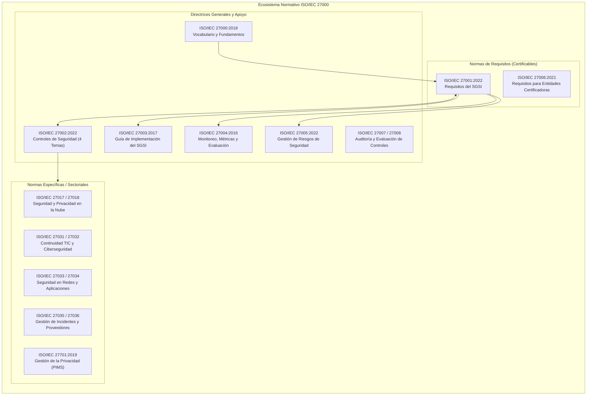
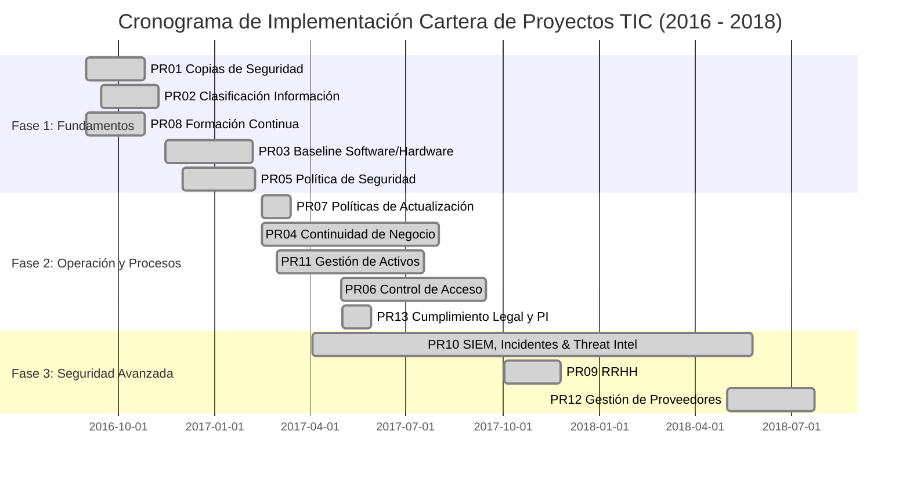

# TP13: Estándar ISO/IEC 27000 y Gestión de Seguridad de la Información (SGSI)

**Asignatura:** Ingeniería de Software II  
**Docente:** Dr. Pedro E. Colla  
**Institución:** Facultad de Ciencia y Tecnología (FCyT) - Universidad Autónoma de Entre Ríos (UADER)  
**Alumno:** Jesús Arévalo  
**Ubicación de Código y Documentación:** `src/tp13/`  

---

## Tabla de Contenidos

1. [Resumen Ejecutivo y Objetivos](#1-resumen-ejecutivo-y-objetivos)
2. [Punto 1: Ecosistema Normativo ISO/IEC 27000 y Evolución 2018 vs 2022](#2-punto-1-ecosistema-normativo-isoiec-27000-y-evolución-2018-vs-2022)
   - [2.1. Normas Formantes del Ecosistema](#21-normas-formantes-del-ecosistema)
   - [2.2. Alcance Resumido de las Principales Normas](#22-alcance-resumido-de-las-principales-normas)
   - [2.3. Principales Conceptos Abordados](#23-principales-conceptos-abordados)
   - [2.4. Principales Diferencias entre la Versión 2018 y 2022](#24-principales-diferencias-entre-la-versión-2018-y-2022)
3. [Punto 2: Grado de Criticidad de Activos en Educación Superior Universitaria](#3-punto-2-grado-de-criticidad-de-activos-en-educación-superior-universitaria)
   - [3.1. Contexto Universitario y Marco Legal (Ley 25.326)](#31-contexto-universitario-y-marco-legal-ley-25326)
   - [3.2. Evaluación Sistemática de Partes Interesadas y Requisitos](#32-evaluación-sistemática-de-partes-interesadas-y-requisitos)
4. [Punto 3: Evaluación SGSI de Educación Superior en Formato Remoto/Virtual](#4-punto-3-evaluación-sgsi-de-educación-superior-en-formato-remotovirtual)
   - [4.1. Actores Involucrados](#41-actores-involucrados)
   - [4.2. Procesos Críticos](#42-procesos-críticos)
   - [4.3. Herramientas y Tecnologías](#43-herramientas-y-tecnologías)
   - [4.4. Activos de Información y Datos](#44-activos-de-información-y-datos)
   - [4.5. Principales Amenazas y Vulnerabilidades](#45-principales-amenazas-y-vulnerabilidades)
   - [4.6. Mapeo de Controles ISO 27002 Recomendados](#46-mapeo-de-controles-iso-27002-recomendados)
5. [Punto 4: Evaluación Cuantitativa de Riesgo y Mapa de Calor](#5-punto-4-evaluación-cuantitativa-de-riesgo-y-mapa-de-calor)
   - [5.1. Definición Paramétrica de Escalas y Umbrales de Apetito](#51-definición-paramétrica-de-escalas-y-umbrales-de-apetito)
   - [5.2. Tabla de Evaluación Cuantitativa (Factores R-01 a R-05)](#52-tabla-de-evaluación-cuantitativa-factores-r-01-a-r-05)
   - [5.3. Análisis Detallado por Escenario de Riesgo y Salvaguardas](#53-análisis-detallado-por-escenario-de-riesgo-y-salvaguardas)
   - [5.4. Mapa de Calor Bidimensional (5x5)](#54-mapa-de-calor-bidimensional-5x5)
6. [Punto 5: Aprendizajes y Problemas Críticos en la Recertificación ISO 27001:2022](#6-punto-5-aprendizajes-y-problemas-críticos-en-la-recertificación-iso-270012022)
   - [6.1. Marco de Referencia (URM Consulting / BSI)](#61-marco-de-referencia-urm-consulting--bsi)
   - [6.2. Decálogo de Problemas Críticos y Recomendaciones de Transición](#62-decálogo-de-problemas-críticos-y-recomendaciones-de-transición)
7. [Punto 6: Análisis Integral del Caso de Estudio TIC](#7-punto-6-análisis-integral-del-caso-de-estudio-tic)
   - [7.1. Diagnóstico Inicial y GAP Analysis (Cláusulas y Dominios)](#71-diagnóstico-inicial-y-gap-analysis-cláusulas-y-dominios)
   - [7.2. Cartera de Proyectos del Plan de Mejora (PR01 a PR13)](#72-cartera-de-proyectos-del-plan-de-mejora-pr01-a-pr13)
   - [7.3. Desglose Económico (CAPEX y OPEX) y Análisis Temporal](#73-desglose-económico-capex-y-opex-y-análisis-temporal)
   - [7.4. Hitos y Cuerpo Documental Desarrollado](#74-hitos-y-cuerpo-documental-desarrollado)
   - [7.5. Comparación Ex-Ante vs Ex-Post y Motivaciones Estratégicas](#75-comparación-ex-ante-vs-ex-post-y-motivaciones-estratégicas)
8. [Estructura de Artefactos, Scripts y Suite de Pruebas Unitarias](#8-estructura-de-artefactos-scripts-y-suite-de-pruebas-unitarias)
9. [Conclusiones](#9-conclusiones)
10. [Referencias Bibliográficas](#10-referencias-bibliográficas)

---

## 1. Resumen Ejecutivo y Objetivos

La seguridad de la información constituye un imperativo estratégico dentro de las organizaciones modernas. Lejos de restringirse a medidas perimetrales de seguridad informática, abarca la preservación sistemática de la **Confidencialidad, Integridad y Disponibilidad (tríada CIA)** de los activos de información mediante políticas organizacionales, procesos auditables, concientización humana y salvaguardas técnicas calibradas con el valor que aportan a la cadena de valor.

El presente trabajo práctico aborda de manera rigurosa y multidisciplinaria los siguientes objetivos:
1. **Modelar el ecosistema normativo de la familia ISO/IEC 27000**, analizando en profundidad la transición entre la revisión de fundamentos 2018 (con la norma certificable 27001:2013) y la reestructuración integral de **ISO/IEC 27001:2022** e **ISO/IEC 27002:2022** (reducción a 4 temas, consolidación a 93 controles, incorporación de 11 controles contemporáneos y sistema de atributos).
2. **Evaluar el grado de criticidad de activos** en un entorno de educación superior (universidad pública argentina), integrando el marco regulatorio nacional (**Ley 25.326 de Protección de Datos Personales**) y los acuerdos interinstitucionales (CONICET/CIN).
3. **Evaluar los componentes sistémicos de un SGSI** aplicados a la educación superior en formato virtual y remoto (actores, procesos, herramientas, activos de datos y vectores de ataque).
4. **Ejecutar una evaluación cuantitativa del riesgo** sobre cinco amenazas críticas (R-01 a R-05), aplicando matrices bidimensionales $5 \times 5$, umbrales de apetito de riesgo y generando un mapa de calor visual de trazabilidad inherente a residual.
5. **Sintetizar las lecciones aprendidas y errores comunes en procesos de recertificación** a partir del informe técnico de **URM Consulting** y **BSI**.
6. **Analizar exhaustivamente el "Caso de Estudio TIC"** desarrollado en las clases del Dr. Pedro E. Colla, cuantificando el diagnóstico diferencial inicial, el desglose económico de los 13 proyectos de mejora (**401.760 €** en implementación y **167.000 €** en mantenimiento anual), el cronograma de ejecución y las motivaciones estratégicas en la cadena de valor.

---

## 2. Punto 1: Ecosistema Normativo ISO/IEC 27000 y Evolución 2018 vs 2022

### 2.1. Normas Formantes del Ecosistema

La familia de normas **ISO/IEC 27000** es desarrollada por el Subcomité Conjunto ISO/IEC JTC 1/SC 27 (*Information security, cybersecurity and privacy protection*). Proporciona un marco integral para la gestión de la seguridad de la información aplicable a cualquier tipo de organización (empresas comerciales, organismos públicos, entidades académicas u ONG).



### 2.2. Alcance Resumido de las Principales Normas

1. **ISO/IEC 27001 (Requisitos del SGSI):** Especifica los requerimientos mandatorios para diseñar, implementar, operar, mantener y mejorar de forma continua un Sistema de Gestión de Seguridad de la Información. Contiene el marco de cláusulas de alto nivel (cláusulas 4 a 10) y el catálogo normativo del Anexo A. Es la única norma del ecosistema contra la cual se emiten certificaciones de conformidad de tercera parte.
2. **ISO/IEC 27002 (Código de Práctica para Controles de Seguridad):** Actúa como guía de referencia técnica y detallada de los controles enunciados en el Anexo A de ISO 27001. Describe el propósito de cada control, directrices de implementación y consideraciones contextuales.
3. **ISO/IEC 27000 (Visión General y Vocabulario):** Establece el marco conceptual, las definiciones formales y la terminología estandarizada para toda la serie 27000.
4. **ISO/IEC 27003 (Guía de Implementación):** Brinda directrices prácticas para planificar, diseñar y ejecutar el proyecto de implantación de un SGSI conforme a ISO/IEC 27001.
5. **ISO/IEC 27004 (Monitoreo, Medición, Análisis y Evaluación):** Establece directrices para la definición de indicadores clave de desempeño (KPI) e indicadores de riesgo (KRI), evaluando la eficacia operativa del SGSI y de sus controles.
6. **ISO/IEC 27005 (Gestión de Riesgos de Seguridad de la Información):** Proporciona pautas sistemáticas para la identificación, análisis, valoración y tratamiento de riesgos de seguridad, alineándose estrechamente con el estándar general de riesgos ISO 31000.
7. **ISO/IEC 27006 (Requisitos para Organismos de Certificación):** Regula los procedimientos de acreditación, competencia de auditores y tiempos mínimos de auditoría para entidades externas certificadoras (ej. BSI, IRAM, TÜV, DNV).
8. **ISO/IEC 27007 & 27008 (Auditoría del SGSI y de Controles):** Guías para la realización de auditorías internas y externas de los procesos del SGSI (27007) y para la verificación técnica de salvaguardas (27008).
9. **ISO/IEC 27017 & 27018 (Cloud Security y Privacidad en la Nube):** Guías especializadas para la provisión y consumo seguro de servicios SaaS, PaaS e IaaS, y la protección de datos personales en la nube pública.
10. **ISO/IEC 27031 (Continuidad de TIC):** Pautas para asegurar que los servicios de telecomunicaciones e infraestructura de TI resistan y se recuperen ante desastres imprevistos (*ICT Readiness for Business Continuity*).
11. **ISO/IEC 27032 (Ciberseguridad):** Directrices para la colaboración, intercambio de inteligencia y protección contra vectores de ataque globales en el ciberespacio.
12. **ISO/IEC 27034 (Seguridad en Aplicaciones):** Integra la seguridad en todas las etapas del ciclo de vida del software (*Secure SDLC*).
13. **ISO/IEC 27035 (Gestión de Incidentes de Seguridad):** Protocolos para la detección, contención, análisis forense, erradicación y lecciones aprendidas de incidentes.
14. **ISO/IEC 27036 (Seguridad en la Cadena de Suministro y Proveedores):** Requisitos de seguridad para la adquisición de productos, tercerización de software y contratos con proveedores.
15. **ISO/IEC 27701 (Sistema de Gestión de la Privacidad - PIMS):** Extensión que complementa ISO 27001/27002 para cumplir con normativas de privacidad globales (GDPR, Ley 25.326).

### 2.3. Principales Conceptos Abordados

- **Información como Activo de la Cadena de Valor:** La información es el activo intangible más valioso de la empresa; su degradación interrumpe los procesos operativos y destruye el valor de negocio.
- **Tríada CIA:**
  - **Confidencialidad:** Propiedad por la cual la información solo resulta accesible y comprensible para personas, entidades o procesos formalmente autorizados.
  - **Integridad:** Salvaguarda de la exactitud, exhaustividad y coherencia de la información y de sus métodos de procesamiento, impidiendo modificaciones o destrucciones no autorizadas.
  - **Disponibilidad:** Garantía de que los usuarios legítimos tengan acceso oportuno e ininterrumpido a la información y a los servicios asociados en el momento requerido.
- **Principios Complementarios:**
  - **Autenticación:** Certeza de que una identidad invocada corresponde fehacientemente al emisor o usuario legítimo.
  - **No Repudio:** Capacidad de probar la ocurrencia de un evento o acción de modo que no pueda ser negado por ninguna de las partes intervinientes (en origen o destino).
- **Modelo de Riesgo (Activo - Amenaza - Vulnerabilidad):**
  - **Activo:** Recurso valioso para la organización (información, software, hardware, personas).
  - **Vulnerabilidad:** Debilidad o fallo intrínseco de un activo susceptible de ser explotado.
  - **Amenaza:** Causa potencial de un incidente no deseado que puede causar daños (pasivas vs. activas).
  - **Riesgo:** Estimación del nivel de exposición ante la probabilidad de que una amenaza explote una debilidad provocando un determinado impacto.
- **Declaración de Aplicabilidad (SoA - Statement of Applicability):** Documento rector del SGSI donde se declaran los controles seleccionados del catálogo, justificando su inclusión o exclusión técnica y legal.
- **Ciclo PDCA (Deming):** Marco iterativo de gestión de la calidad:
  - **Plan (Planificar):** Alcance, política, análisis de riesgos y selección de controles.
  - **Do (Hacer):** Implementación de controles, formación y operación del SGSI.
  - **Check (Verificar):** Auditorías internas, revisión por la dirección y monitoreo de métricas.
  - **Act (Actuar):** Acciones correctivas y mejoras continuas.

### 2.4. Principales Diferencias entre la Versión 2018 y 2022

| Eje de Comparación | Versión 2018 (ISO 27000:2018 / ISO 27001:2013) | Versión 2022 (ISO 27001:2022 / ISO 27002:2022) |
| :--- | :--- | :--- |
| **Título Oficial** | *Information technology - Security techniques* | *Information security, cybersecurity and privacy protection* |
| **Estructura del Anexo A** | 14 dominios rígidos (A.5 a A.18) y 35 objetivos de control | **4 temas modulares:** Organizacional (37 controles), Personas (8 controles), Físico (14 controles) y Tecnológico (34 controles) |
| **Volumen de Controles** | 114 controles | **93 controles** (57 fusionados, 35 mantenidos intactos, 1 eliminado, **11 nuevos controles**) |
| **Control Eliminado** | A.11.2.5 (Retiro de activos de la organización) | Suprimido por redundancia con gestión general de activos |
| **Nuevos Controles** | No existían formalmente | 11 controles contemporáneos que responden al estado actual del ciberdelito |
| **Sistema de Atributos** | Sin etiquetas estandarizadas | Cada control incluye **5 tablas de atributos** (#Control_Types, #InfoSec_Properties, #Cybersecurity_Concepts, #Operational_Capabilities, #Security_Domains) |
| **Alineación Cláusulas** | Estructura tradicional de alto nivel | **Estructura Armonizada ISO (Annex SL)** con Cláusula 6.3 (Planificación de cambios), Cláusula 6.2 (Monitoreo de objetivos) y Cláusula 8.1 (Control operacional) |

#### Los 11 Nuevos Controles de ISO/IEC 27002:2022:
1. **5.7 Inteligencia de amenazas (*Threat intelligence*):** Recopilación y análisis sistemático de datos sobre amenazas emergentes para adoptar salvaguardas preventivas.
2. **5.23 Seguridad de la información para el uso de servicios en la nube (*Cloud services*):** Procesos para la adquisición, gestión, monitoreo y rescisión de servicios cloud.
3. **5.30 Preparación de las TIC para la continuidad del negocio (*ICT readiness for BC*):** Garantía de resiliencia y disponibilidad de infraestructura TIC ante desastres.
4. **7.4 Monitoreo de seguridad física (*Physical security monitoring*):** Vigilancia perimetral continua mediante CCTV, sensores de intrusión y alarmas.
5. **8.9 Gestión de configuraciones (*Configuration management*):** Establecimiento, documentación y control de configuraciones seguras (*baselines*).
6. **8.10 Eliminación de información (*Information deletion*):** Borrado seguro de datos almacenados en sistemas y medios de almacenamiento para evitar su recuperación indebida.
7. **8.11 Enmascaramiento de datos (*Data masking*):** Ofuscación, seudonimización o truncamiento de datos confidenciales (PII) según necesidades de uso.
8. **8.12 Prevención de fuga de datos (*Data leakage prevention - DLP*):** Detección y bloqueo de transferencia no autorizada de información sensible hacia el exterior.
9. **8.16 Monitoreo de actividades (*Monitoring activities*):** Registro y análisis continuo del comportamiento de redes, servidores y accesos anómalos.
10. **8.23 Filtrado web (*Web filtering*):** Bloqueo de acceso a sitios web fraudulentos o maliciosos desde la red corporativa.
11. **8.28 Codificación segura (*Secure coding*):** Adopción formal de principios de desarrollo de software seguro (OWASP Top 10, validación de inputs, SAST/DAST).

---

## 3. Punto 2: Grado de Criticidad de Activos en Educación Superior Universitaria

### 3.1. Contexto Universitario y Marco Legal (Ley 25.326)

En una universidad pública nacional/provincial (como la FCyT - UADER), los sistemas informáticos sustentan la misión esencial del Estado: la educación universitaria, la expedición de títulos con validez nacional y la generación de conocimiento científico-tecnológico.

El tratamiento de información personal está regulado estrictamente por la **Ley Nacional N° 25.326 de Protección de los Datos Personales**, la cual impone responsabilidades civiles, penales y administrativas a los responsables de bases de datos que sufran filtraciones por negligencia en la adopción de medidas de seguridad.

### 3.2. Evaluación Sistemática de Partes Interesadas y Requisitos

| Parte Interesada | Requisito de Seguridad | Fuente Normativa/Legal | Grado de Criticidad | Justificación Detallada y Dimensiones CIA |
| :--- | :--- | :--- | :--- | :--- |
| **Estudiantes** | Protección de Información de Identificación Personal (PII); acceso ininterrumpido al Learning Management System (LMS) 24x7 | Ley 25.326 / Contratos nube (SaaS/IaaS) | **CRÍTICA (Muy Alta)** | **Confidencialidad, Privacidad y Disponibilidad:** La universidad custodia bases de datos con DNI, domicilios, legajos, situaciones de salud y datos biométricos. La divulgación no autorizada viola la Ley 25.326 y expone a la institución a sanciones directas de la AAIP. Por otro lado, la indisponibilidad del LMS en períodos de cursado o exámenes paraliza la actividad académica, vulnerando el derecho a la educación superior. |
| **Docentes** | Integridad inalterable de calificaciones; disponibilidad de actas de examen | Normativa interna / Estatuto universitario / Reglamentos de cátedra | **CRÍTICA (Muy Alta)** | **Integridad y Disponibilidad:** Las calificaciones volcadas en actas oficiales revisten el carácter de instrumentos públicos fehacientes. Cualquier vulneración que altere calificaciones destruye la fe pública de los títulos y certificaciones expedidas, constituyendo un delito penal. Asimismo, el sistema debe estar plenamente disponible en las ventanas de cierre de actas para no demorar egresos ni correlatividades. |
| **Ministerio / CONICET** | Confidencialidad de líneas de investigación, patentes, tesis y convenios | Convenios interinstitucionales / Ley de Propiedad Intelectual 11.723 / NDAs | **ALTA** | **Confidencialidad e Integridad:** Los proyectos de I+D financiados por CONICET, MINCyT o empresas privadas contienen datos experimentales y algoritmos propietarios antes de su publicación o patentamiento. Una fuga de información destruiría la novedad de las patentes y generaría la rescisión unilateral de convenios y financiamientos de investigación. |
| **Proveedores Nube** | Garantía de SLA (disponibilidad), cifrado (reposo/tránsito) y retención de logs | Contratos de Servicio / Service Level Agreements (SLA) | **ALTA** | **Disponibilidad, Trazabilidad y Seguridad Lógica:** La tercerización en proveedores cloud (IaaS/PaaS/SaaS) traslada la operación técnica pero no la responsabilidad jurídica final de la universidad. Es crítico que el contrato exija un SLA $\ge 99.9\%$, cifrado fuerte (AES-256, TLS 1.3) y retención inmutable de logs de auditoría para permitir el análisis forense ante incidentes. |

---

## 4. Punto 3: Evaluación SGSI de Educación Superior en Formato Remoto/Virtual

La virtualización de la enseñanza superior extiende el perímetro de seguridad hacia los hogares de los usuarios, exigiendo un enfoque holístico del SGSI.

```mermaid
graph TD
    subgraph SGSI_Virtual["SGSI en Educación Superior Remota / Virtual"]
        subgraph Actores["Actores"]
            A1["Estudiantes (BYOD)"]
            A2["Docentes"]
            A3["SysAdmins / TI"]
            A4["Bedelía / Decanato"]
            A5["Proveedores Cloud"]
        end

        subgraph Herramientas["Herramientas"]
            H1["LMS Moodle"]
            H2["SIU Guaraní"]
            H3["Videoconferencias (Meet/Zoom)"]
            H4["Correo Institucional"]
            H5["WAF / Firewalls / VPNs"]
        end

        subgraph Procesos["Procesos"]
            P1["Matriculación e IAM (SSO)"]
            P2["Clases Sincrónicas/Asincrónicas"]
            P3["Exámenes y Evaluaciones Virtuales"]
            P4["Cierre y Firma Digital de Actas"]
            P5["Backup y Continuidad BCP/DRP"]
        end

        subgraph Informacion["Información / Datos"]
            I1["PII Estudiantes y Legajos"]
            I2["Bancos de Exámenes y Notas"]
            I3["Propiedad Intelectual de Cátedras"]
            I4["Logs y Huellas de Auditoría"]
        end
    end

    Actores --> Procesos
    Procesos --> Herramientas
    Herramientas --> Informacion
```



### 4.1. Actores Involucrados
- **Estudiantes:** Usuarios remotos heterogéneos que acceden desde redes Wi-Fi residenciales inseguras y dispositivos personales no administrados (*BYOD*).
- **Docentes:** Diseñadores instruccionales y evaluadores que administran aulas virtuales, cargan evaluaciones y asientan actas.
- **Administradores de TI / SysAdmins:** Encargados de la configuración, mantenimiento, parches y aprovisionamiento de permisos en servidores y nubes.
- **Autoridades y Bedelía:** Responsables de la validación académica, expedición de títulos y custodia legal de registros.
- **Proveedores Externos (Cloud Vendors):** Proveedores de infraestructura (Google Workspace, AWS, Microsoft Azure, MoodleCloud).

### 4.2. Procesos Críticos
- **Gestión de Identidades y Accesos (IAM):** Autenticación, asignación de roles y control de privilegios.
- **Dictado de Clases Virtuales:** Videoconferencias en vivo y entrega asincrónica de contenidos.
- **Evaluaciones y Exámenes Parciales/Finales:** Creación de cuestionarios, control de entrega de trabajos y validación de autoría.
- **Cierre y Validación de Actas de Examen:** Registro de notas finales en SIU Guaraní y firma digital de autoridades.
- **Respaldo y Continuidad Académica:** Copias de seguridad automáticas de aulas virtuales y bases de datos.

### 4.3. Herramientas y Tecnologías
- **LMS (Learning Management System):** Moodle institucional alojado en servidores locales o nube.
- **Sistema de Gestión Académica:** SIU Guaraní (sistema nacional universitario argentino).
- **Herramientas de Videoconferencia:** Google Meet, Zoom o Microsoft Teams con cuentas institucionales.
- **Seguridad Perimetral y Redes:** Web Application Firewall (WAF), balanceadores de carga, VPNs de acceso administrativo con SSL.

### 4.4. Activos de Información y Datos
- **Información de Identificación Personal (PII):** DNI, dirección, teléfonos, situación arancelaria o de becas.
- **Instrumentos de Evaluación:** Enunciados de exámenes antes de su administración y rúbricas de corrección.
- **Propiedad Intelectual:** Libros, diapositivas de cátedra, artículos de investigación no publicados y tesis.
- **Logs de Auditoría:** Trazas de conexión HTTP, direcciones IP de origen, marcas de tiempo de entrega y bitácoras de cambios en bases de datos.

### 4.5. Principales Amenazas y Vulnerabilidades
- **Suplantación de Identidad en Exámenes:** Falta de autenticación de dos factores que permite a terceros rendir por un alumno.
- **Filtración Previa de Exámenes:** Permisos de lectura laxos en repositorios de cátedra que exponen evaluaciones antes de tiempo.
- **Ataques de Phishing Institucional:** Correos falsos dirigidos a docentes para capturar credenciales de SIU Guaraní.
- **Denegación de Servicio (DoS/DDoS):** Colapso del LMS en momentos de entrega obligatoria o mesas de exámenes.

### 4.6. Mapeo de Controles ISO 27002 Recomendados
- **Control 5.15 / 5.18 (Gestión de Accesos):** Implementación de MFA obligatorio para todo el personal docente y administrativo.
- **Control 6.7 (Trabajo Remoto / Teletrabajo):** Requisitos de seguridad para el uso de equipos personales (antivirus actualizado, sesiones cifradas).
- **Control 8.24 (Criptografía):** Uso estricto de HTTPS (TLS 1.3) y bases de datos cifradas en reposo con AES-256.
- **Control 8.12 (DLP - Data Leakage Prevention):** Restricción de descargas masivas no autorizadas de padrones y listados de alumnos.
- **Control 8.16 (Monitoreo de Actividades):** Registro inmutable de transacciones críticas en SIU Guaraní y alertas por accesos concurrentes sospechosos.

---

## 5. Punto 4: Evaluación Cuantitativa de Riesgo y Mapa de Calor

### 5.1. Definición Paramétrica de Escalas y Umbrales de Apetito

Conforme a las pautas metodológicas de la consigna y la teoría de análisis de riesgos (ISO 27005 / Cátedra Dr. Pedro E. Colla):

#### Escala de Probabilidad ($P \in [1, 5]$):
- **1 (Muy baja):** Frecuencia $\le 1$ vez cada 5 años. Rara o improbable.
- **2 (Baja):** Frecuencia de 1 vez cada 2 a 3 años. Ocasional.
- **3 (Media):** Frecuencia de 1 vez al año. Moderada.
- **4 (Alta):** Frecuencia de 1 vez por trimestre. Frecuente.
- **5 (Crítica):** Frecuencia $\ge 1$ vez al mes. Recurrente o casi constante.

#### Escala de Impacto ($I \in [1, 5]$):
- **1 (Menor):** Sin impacto operativo apreciable; restablecimiento en horas.
- **2 (Bajo):** Afectación menor; interrupción $< 1$ día; daño financiero marginal.
- **3 (Moderado):** Afectación localizada; interrupción de 1 a 2 días; impacto legal subsanable.
- **4 (Mayor):** Impacto grave; interrupción de 3 a 6 días; exposición legal y financiera importante.
- **5 (Catastrófico):** Parálisis masiva $\ge 1$ semana; pérdida irreversible de información; responsabilidad legal severa.

#### Perfil de Apetito de Riesgo (Umbrales):
$$R = P \times I$$
- **Riesgo Aceptable:** $R \le 6$ (Zona Verde: Asumible por la operación sin acciones especiales).
- **Riesgo Tolerable con PTR:** $7 \le R \le 12$ (Zona Amarilla: Requiere Plan de Tratamiento de Riesgos y monitoreo).
- **Riesgo Inaceptable:** $R \ge 15$ (Zona Roja: Requiere accionar inmediato de mitigación y patrocinio ejecutivo).

> **Demostración de Partición Exhaustiva:** En una matriz discreta $5 \times 5$, el conjunto de productos posibles es:
> $$\mathcal{S} = \{1, 2, 3, 4, 5, 6, 8, 9, 10, 12, 15, 16, 20, 25\}$$
> Dado que ningún par de enteros en $[1, 5]$ produce 13 ni 14 ($13$ es primo y $14 = 2 \times 7$), los tres rangos ($\le 6$, $7-12$, $\ge 15$) cubren sin fisuras ni solapamientos el 100% de los estados posibles.

### 5.2. Tabla de Evaluación Cuantitativa (Factores R-01 a R-05)

| ID | Activo / Proceso | Amenaza | Vulnerabilidad | P_Inh | I_Inh | R_Inh | Nivel Inherente | Salvaguardas Aplicadas (Notas) | P_Res | I_Res | R_Res | Nivel Residual |
| :---: | :--- | :--- | :--- | :---: | :---: | :---: | :--- | :--- | :---: | :---: | :---: | :--- |
| **R-01** | DB alumnos | Ransomware | Parches atrasados | 4 | 5 | **20** | **Inaceptable (Inmediato)** | Crítico; planes BRS/backup inmutable (3-2-1) + gestión estricta de parches + segmentación de red | 2 | 3 | **6** | **Aceptable** |
| **R-02** | LMS (Campus Virtual) | DDoS | Sin Firewall | 4 | 4 | **16** | **Inaceptable (Inmediato)** | Mitigar con Firewall / WAF perimetral + Protección anti-DDoS en la nube + Rate Limiting | 2 | 2 | **4** | **Aceptable** |
| **R-03** | Email Institucional | Phishing | Conciencia baja | 5 | 3 | **15** | **Inaceptable (Inmediato)** | Campañas periódicas de simulación + 2FA obligatorio en cuentas + DMARC, SPF y DKIM en DNS | 2 | 2 | **4** | **Aceptable** |
| **R-04** | SIU Guaraní | Interrupción eléctrica | Redundancia limitada | 3 | 3 | **9** | **Tolerable con PTR** | UPS online de doble conversión + Grupo electrógeno diésel con conmutación automática (ATS) | 2 | 1 | **2** | **Aceptable** |
| **R-05** | Doc repositorio | Fuga PII | Acceso laxo | 4 | 4 | **16** | **Inaceptable (Inmediato)** | RBAC (Control de acceso por roles) + DLP (Prevención de fuga) + Clasificación formal de documentos | 2 | 2 | **4** | **Aceptable** |

### 5.3. Análisis Detallado por Escenario de Riesgo y Salvaguardas

1. **R-01: Base de Datos de Alumnos - Ransomware por Parches Atrasados**
   - **Riesgo Inherente ($P=4, I=5 \rightarrow R=20$, Inaceptable):** Las bases de datos que no reciben parches periódicos de seguridad están expuestas a exploits de ejecución remota de código (RCE) conocidos públicamente. Un ataque de ransomware cifra las tablas del SIU y legajos, impidiendo inscripciones y exámenes durante semanas ($I=5$).
   - **Salvaguardas:** Plan formal de Respaldo y Recuperación (**BRS**), política de backups 3-2-1 con copias desconectadas (*air-gapped* o inmutables en almacenamiento WORM), junto con un proceso estricto de gestión de parches en ventanas de mantenimiento.
   - **Riesgo Residual ($P=2, I=3 \rightarrow R=6$, Aceptable):** Con parches al día la probabilidad cae a 2, y ante una eventual infección, la capacidad de restaurar desde backups inmutables en menos de 24-48 horas reduce el impacto a moderado ($I=3$).

2. **R-02: LMS Institucional - Ataque DDoS por Falta de Firewall**
   - **Riesgo Inherente ($P=4, I=4 \rightarrow R=16$, Inaceptable):** Un servidor web Moodle expuesto directamente a Internet sin filtro perimetral es víctima fácil de ataques volumétricos (SYN flood, UDP amplification) o de capa de aplicación (HTTP flood), provocando la caída del campus por días en fechas de exámenes.
   - **Salvaguardas:** Despliegue de un **Firewall perimetral y Web Application Firewall (WAF)** con capacidad de mitigación anti-DDoS distribuida (ej. Cloudflare / AWS CloudFront / Fortinet) y limitación de tasa de solicitudes (*Rate Limiting*).
   - **Riesgo Residual ($P=2, I=2 \rightarrow R=4$, Aceptable):** El tráfico malicioso es filtrado automáticamente en los nodos perimetrales sin saturar el servidor de origen.

3. **R-03: Correo Electrónico Institucional - Phishing por Conciencia Baja del Personal**
   - **Riesgo Inherente ($P=5, I=3 \rightarrow R=15$, Inaceptable):** Sin concientización, los usuarios ingresan habitualmente sus credenciales en sitios clonados. Al ocurrir intentos todos los meses ($P=5$), se comprometen cuentas institucionales que son usadas para diseminar spam o intentar fraude de transferencias.
   - **Salvaguardas:** Campañas de formación continua con simulacros de phishing, imposición obligatoria de **Autenticación en Dos Factores (2FA/MFA)** y configuración estricta de registros de autenticación de correo: **SPF**, **DKIM** y **DMARC** con directiva `p=reject`.
   - **Riesgo Residual ($P=2, I=2 \rightarrow R=4$, Aceptable):** Aun si un usuario revela su contraseña por error, el atacante no puede acceder sin el token de 2FA; y DMARC impide el spoofing del dominio universitario.

4. **R-04: SIU Guaraní - Interrupción Eléctrica por Redundancia Limitada**
   - **Riesgo Inherente ($P=3, I=3 \rightarrow R=9$, Tolerable con PTR):** Los cortes de la red comercial en épocas de alta demanda ocurren varias veces al año ($P=3$). Si las baterías del UPS tienen autonomía limitada y no hay generador, el servidor se apaga abruptamente, corrompiendo transacciones en curso de la base de datos PostgreSQL ($I=3$).
   - **Salvaguardas:** **UPS modular online de doble conversión** con autonomía suficiente para estabilización y apagado ordenado, complementado con un **Grupo Electrógeno diésel** con tablero de transferencia automática (ATS) que arranca en menos de 60 segundos.
   - **Riesgo Residual ($P=2, I=1 \rightarrow R=2$, Aceptable):** La conmutación eléctrica es transparente para el hardware, eliminando el riesgo de caída del servicio.

5. **R-05: Repositorio Documental - Fuga de PII por Acceso Laxo**
   - **Riesgo Inherente ($P=4, I=4 \rightarrow R=16$, Inaceptable):** Si las carpetas compartidas carecen de permisos granulares, cualquier usuario puede acceder o descargar legajos con DNI y datos sensibles de estudiantes y docentes, exponiendo a la universidad a demandas y sanciones bajo la Ley 25.326.
   - **Salvaguardas:** Implementación de **Control de Acceso Basado en Roles (RBAC)** con principio de menor privilegio, herramientas de **Data Loss Prevention (DLP)** para monitorear y bloquear la exfiltración masiva de datos, y **clasificación formal de la información** (Pública, Interna, Confidencial, Restringida).
   - **Riesgo Residual ($P=2, I=2 \rightarrow R=4$, Aceptable):** Los datos sensibles quedan cifrados y restringidos exclusivamente al personal autorizado de Bedelía/Secretaría.

### 5.4. Mapa de Calor Bidimensional (5x5)

El script [evaluacion_riesgo.py](file:///c:/Users/Usuario/Desktop/is2_arevalo/src/tp13/evaluacion_riesgo.py) calculó e interactuó con la matriz paramétrica, generando la visualización gráfica de alta resolución [mapa_calor_riesgos.png](file:///c:/Users/Usuario/Desktop/is2_arevalo/src/tp13/mapa_calor_riesgos.png):

```
       Probabilidad (P)
         ▲
       5 |  [ 5 ]   [ 10 ]   [ 15: R-03(Inh) ]  [ 20 ]               [ 25 ]
       4 |  [ 4 ]   [  8 ]   [ 12 ]             [ 16: R-02,R-05(Inh) ] [ 20: R-01(Inh) ]
       3 |  [ 3 ]   [  6 ]   [  9: R-04(Inh) ]  [ 12 ]               [ 15 ]
       2 |  [ 2:R-04(Res)] [4:R-02,03,05(Res)] [6:R-01(Res)] [ 8 ]  [ 10 ]
       1 |  [ 1 ]   [  2 ]   [  3 ]             [  4 ]               [  5 ]
         +------------------------------------------------------------------► Impacto (I)
               1        2          3                4                  5
```


> **Interpretación Visual del Mapa:** Los cuatro riesgos inicialmente inaceptables ($R \ge 15$, puntos rojos R-01, R-02, R-03, R-05) y el riesgo tolerable ($R=9$, punto amarillo R-04) son desplazados mediante las líneas de salvaguardas hacia la zona verde de riesgo plenamente aceptable ($R \le 6$, cuadrados verdes), verificando la eficacia del tratamiento bajo los estándares del SGSI.

---

## 6. Punto 5: Aprendizajes y Problemas Críticos en la Recertificación ISO 27001:2022

### 6.1. Marco de Referencia (URM Consulting / BSI)

Con base en el análisis empírico realizado por **Wayne Armstrong** (Senior Consultant de URM), **Thomas Harrison** (Partnership Manager de BSI) y **Lisa Dargan** (*"Lessons Learnt from Early ISO 27001:2022 Transitions"*, 2024), se examinaron los tropiezos recurrentes que experimentan las organizaciones al transitar desde ISO/IEC 27001:2013 hacia ISO/IEC 27001:2022.

### 6.2. Decálogo de Problemas Críticos y Recomendaciones de Transición

1. **No Actualizar la Declaración de Aplicabilidad (SoA):**
   - *Problema:* El SoA es el primer documento examinado por los auditores de certificación. Si el SoA mantiene los códigos de 2013 (A.5 a A.18) o no refleja los 4 temas nuevos de 2022, el auditor concluye inmediatamente que la transición no se ha iniciado formalmente.
   - *Solución:* Reestructurar el SoA con los 93 controles agrupados en temas (Organizacional, Personas, Físico, Tecnológico), justificando su aplicabilidad y documentando el nuevo "propósito" asignado a cada salvaguarda.
2. **Confusión en los Plazos del Cronograma de Transición (*Timeline*):**
   - *Problema:* Muchas empresas asumen que pueden postergar la transición hasta el 31 de octubre de 2025 (fecha final de vigencia de certificados ISO 27001:2013). Sin embargo, desconocen que **a partir del 1 de mayo de 2024, todas las auditorías iniciales y de recertificación trienal deben realizarse obligatoriamente bajo ISO/IEC 27001:2022**.
   - *Solución:* Revisar el calendario de vencimiento del ciclo de certificación propio y agendar con la entidad certificadora la auditoría de transición con meses de anticipación.
3. **Abandono Prematuro de la Conformidad con la Versión 2013:**
   - *Problema:* Empresas que eliminan sus controles viejos antes de completar la auditoría de transición. Mientras el organismo certificador no emita formalmente el certificado 2022, la organización sigue contractualmente obligada a cumplir ISO 27001:2013.
   - *Solución:* Mantener un **SoA con doble columna de mapeo cruzado** (mostrando la equivalencia entre controles 2013 y 2022) hasta la aprobación final.
4. **Desactualización de la Documentación Operativa de Soporte:**
   - *Problema:* Se actualiza el SoA pero no se revisan los manuales de procedimientos, políticas operativas, matrices de riesgo ni programas de auditoría interna, los cuales continúan haciendo referencia a los números de control de 2013.
   - *Solución:* Ejecutar un análisis de impacto documental para actualizar todas las referencias cruzadas en el cuerpo procedimental.
5. **Subestimar Pequeños Cambios de Redacción (*Wording Changes*):**
   - *Problema:* Creer que un cambio de redacción menor en una cláusula no impacta en la práctica. En las normas ISO, pequeñas adiciones textuales introducen exigencias de generación de evidencias operativas tangibles.
   - *Solución:* Comparar minuciosamente los textos normativos y verificar qué nuevas evidencias objetivas requiere cada cláusula.
6. **Desactualización de Competencias en Auditores Internos e Implementadores:**
   - *Problema:* Realizar auditorías internas con personal que solo conoce la versión 2013 o que desconoce las directrices de la guía complementaria ISO/IEC 27002:2022.
   - *Solución:* Capacitar al equipo auditor en la estructura de 4 temas, en los 11 controles nuevos y en el marco de mejores prácticas de ISO 27002:2022.
7. **Complejidad en la Cláusula 6.3 (Planificación de Cambios):**
   - *Problema:* Esta cláusula exige documentar y evidenciar la gestión del cambio dentro del propio SGSI. Muchas organizaciones implementan las modificaciones sin generar registros formales de aprobación.
   - *Solución:* Utilizar el propio proceso de transición a ISO 27001:2022 como evidencia de cumplimiento, registrando en minutas de la dirección los planes de cambio, recursos asignados y autorizaciones.
8. **Requisitos Rigurosos en Cláusula 6.2 (Objetivos) y 8.1 (Control Operacional):**
   - *Problema:* La cláusula 6.2 ahora exige explícitamente *monitorear* los objetivos de seguridad; y la cláusula 8.1 exige fijar criterios y controles documentados para las acciones derivadas de la gestión de riesgos.
   - *Solución:* Establecer tableros de control con indicadores de cumplimiento periódicos (KPIs de seguridad).
9. **Desafíos Técnicos en Controles Críticos del Anexo A (5.7 y 8.11):**
   - *Problema:* El **Control 5.7 (Threat intelligence)** requiere un proceso dinámico de adquisición y análisis de ciberamenazas (no una revisión anual estática). El **Control 8.11 (Data masking)** exige capacidades técnicas de enmascaramiento, seudonimización o truncamiento de datos personales.
   - *Solución:* Suscribirse a feeds de inteligencia de amenazas e implementar herramientas de ofuscación de datos en entornos de prueba y producción.
10. **Alineación con la Estructura Armonizada (Evitar Duplicaciones):**
    - *Problema:* Crear una capa burocrática paralela para ISO 27001 desconectada de otros sistemas de gestión existentes (ISO 9001, ISO 22301).
    - *Solución:* Aprovechar los procesos ya certificados de gestión del cambio, auditorías internas y revisiones directivas, unificando el gobierno corporativo.

---

## 7. Punto 6: Análisis Integral del Caso de Estudio TIC

### 7.1. Diagnóstico Inicial y GAP Analysis (Cláusulas y Dominios)

El **Caso de Estudio TIC**, expuesto en las diapositivas de cátedra del Dr. Pedro E. Colla (láminas 8 a 16), documenta la experiencia real de una empresa de base tecnológica (desarrollo de software y servicios TIC) que inicia su camino hacia la certificación ISO 27001.

- **Nivel de Madurez Inicial:** La organización se encontraba en **Nivel L1 (Inicial / Ad-hoc)** con una efectividad estimada del 10%, caracterizada por procedimientos aislados dependientes exclusivamente del esfuerzo individual de personas clave, y áreas en **Nivel L0 (Inexistente)**.
- **GAP Analysis contra ISO 27001:2013 (Requisitos 4 a 10):**
  - Cláusula 4 (Contexto de la organización): 5% conformidad (5 No Conformidades Mayores).
  - Cláusula 5 (Liderazgo): 1% conformidad (14 NC Mayores).
  - Cláusula 6 (Planificación): 0% conformidad (31 NC Mayores).
  - Cláusula 7 (Soporte): 10% conformidad (14 NC Mayores, 3 NC Menores).
  - Cláusula 8 (Funcionamiento / Operación): 0% conformidad (3 NC Mayores).
  - Cláusula 9 (Evaluación de Rendimiento): 5% conformidad (23 NC Mayores).
  - Cláusula 10 (Proceso de Mejora): 0% conformidad (11 NC Mayores).
  - **Total:** **101 No Conformidades Mayores**, evidenciando la carencia absoluta de un marco formal de gobierno de la seguridad.
- **GAP Analysis contra ISO 27002:2013 (Dominios A.5 a A.18):**
  - Conformidad promedio inicial global: **~17%**.
  - Pese a ser una empresa tecnológica con un cumplimiento relativo del **70% en el dominio A.14 (Adquisición, desarrollo y mantenimiento de sistemas)**, presentaba debilidades críticas en Criptografía (A.10: 5%), Incidentes (A.16: 5%), Continuidad del Negocio (A.17: 2%) y Operaciones (A.12: 8%).

### 7.2. Cartera de Proyectos del Plan de Mejora (PR01 a PR13)

Para subsanar las 101 NC mayores y elevar la madurez institucional, la dirección técnica diseñó una cartera de **13 proyectos de mejora**:



### 7.3. Desglose Económico (CAPEX y OPEX) y Análisis Temporal

El script [caso_estudio_tic.py](file:///c:/Users/Usuario/Desktop/is2_arevalo/src/tp13/caso_estudio_tic.py) modeló la cartera de inversión:

| ID | Proyecto de Mejora | Coste Impl. (CAPEX) | % CAPEX | Coste Mant. Anual (OPEX) | % OPEX | Duración |
| :---: | :--- | :---: | :---: | :---: | :---: | :---: |
| **PR01** | Copias de Seguridad | 34.640,00 € | 8,62% | 10.440,00 € | 6,25% | 8 sem. |
| **PR02** | Organización y Clasificación de la Información | 2.480,00 € | 0,62% | 4.000,00 € | 2,40% | 8 sem. |
| **PR03** | Definición de Baseline en Software y Hardware | 4.640,00 € | 1,15% | 6.400,00 € | 3,83% | 12 sem. |
| **PR04** | Plan de Continuidad de Negocio | 16.000,00 € | 3,98% | 7.200,00 € | 4,31% | 24 sem. |
| **PR05** | Política de Seguridad de la Información | 4.560,00 € | 1,14% | 9.600,00 € | 5,75% | 10 sem. |
| **PR06** | Política de Control de Acceso | 36.200,00 € | 9,01% | 6.240,00 € | 3,74% | 20 sem. |
| **PR07** | Definición de Políticas de Actualización | 3.200,00 € | 0,80% | 4.640,00 € | 2,78% | 4 sem. |
| **PR08** | Programa de Formación Continua | 27.280,00 € | 6,79% | 27.280,00 € | 16,34% | 8 sem. |
| **PR09** | Seguridad en Recursos Humanos (RRHH) | 3.200,00 € | 0,80% | 4.800,00 € | 2,87% | 8 sem. |
| **PR10** | **Gestión Incidentes, SIEM, Logs & Threat Intel** | **251.000,00 €** | **62,48%** | **69.600,00 €** | **41,68%** | **60 sem.** |
| **PR11** | Plan de Gestión de Activos de Empresa y Empleados | 9.600,00 € | 2,39% | 8.800,00 € | 5,27% | 20 sem. |
| **PR12** | Gestión de Proveedores | 7.360,00 € | 1,83% | 6.400,00 € | 3,83% | 12 sem. |
| **PR13** | Cumplimiento de Legislación y Propiedad Intelectual | 1.600,00 € | 0,40% | 1.600,00 € | 0,96% | 4 sem. |
| **TOTAL** | **INVERSIÓN TOTAL DE LA CARTERA** | **401.760,00 €** | **100,00%** | **167.000,00 €** | **100,00%** | **2 años** |


> **Observación Económica Clave:** El proyecto **PR10** concentra el **62,48% de la inversión de implementación (251.000 €)** y el **41,68% del mantenimiento anual (69.600 €)**, con una duración de 60 semanas. Esto demuestra que en empresas TIC el mayor esfuerzo económico no radica en redactar políticas (PR02, PR05, PR07 insumen presupuestos menores de 2.000 a 4.000 €), sino en desplegar la **infraestructura técnica de monitoreo continuo, telemetría de eventos (SIEM), correlación de logs e inteligencia contra amenazas en tiempo real**.

### 7.4. Hitos y Cuerpo Documental Desarrollado

Como resultado de la ejecución del plan, la organización consolidó hitos estructurales:
- Definición formal de roles, responsabilidades y patrocinio ejecutivo.
- Sistema unificado de gestión documental.
- Procedimiento formal de análisis de riesgos de seguridad.
- Programa anual de auditorías internas e indicadores de gestión (KPIs).
- Cuerpo documental aprobado de 13 políticas corporativas: Clasificación de información, Control de acceso, Uso aceptable de recursos, Acceso remoto/teletrabajo, Comunicación de información, Gestión de activos, Continuidad de negocio, Incidentes, Cifrado, Seguridad operativa, RRHH, Seguridad física/ambiental, y Relación con suministradores.

### 7.5. Comparación Ex-Ante vs Ex-Post y Motivaciones Estratégicas


#### Salto de Conformidad:
- **Ex-Ante:** Cobertura deficiente (~17% promedio), con vacíos críticos en Criptografía (5%), Incidentes (5%) y Continuidad (2%).
- **Ex-Post:** Cobertura superior al **85% - 95%** en todos los 14 dominios de ISO 27002, permitiendo alcanzar la certificación formal (la cual tiene vigencia de 2 a 3 años y requiere auditorías de seguimiento).

#### Aspectos que más Contribuyen a la Comprensión de las Motivaciones Estratégicas:
1. **La Seguridad como Preservación del Core del Negocio:** En una organización TIC, el código fuente, la infraestructura cloud y las bases de datos de clientes *son* el producto. Protegerlos no es un centro de costos, sino la defensa de los activos generadores de ingresos.
2. **Habilitador Comercial Indispensable (Diferenciador en Licitaciones):** En el mercado corporativo y gubernamental contemporáneo, certificar ISO 27001 es condición *sine qua non* (excluyente) para calificar como proveedor confiable. La certificación transforma el gasto de seguridad en un activo comercial que incrementa las ventas.
3. **Racionalidad Financiera y Pérdida Máxima Aceptable:** Como expresa la cátedra: *"La norma alienta que la escala económica sea consistente con el valor"*. Invertir 401.760 € en 2 años es económicamente racional si se compara con el coste de un incidente grave de ransomware en una empresa tecnológica (rescates que superan los millones de dólares, demandas judiciales de clientes, lucro cesante y daño reputacional irreparable).
4. **Resiliencia Operativa y Continuidad:** Disponer de planes probados de recuperación ante desastres (PR01 y PR04) y monitoreo en tiempo real (PR10) garantiza que la compañía sobreviva a contingencias graves, asegurando su permanencia a largo plazo en el mercado.

---

## 8. Estructura de Artefactos, Scripts y Suite de Pruebas Unitarias

El módulo `src/tp13/` cuenta con una arquitectura de software modular y verificada:

- [evaluacion_riesgo.py](file:///c:/Users/Usuario/Desktop/is2_arevalo/src/tp13/evaluacion_riesgo.py): Script en Python que implementa los modelos orientados a objetos `RiesgoFactor` y `MatrizRiesgo`, calculando niveles de riesgo inherente y residual, formateando reportes y renderizando el mapa de calor bidimensional.
- [caso_estudio_tic.py](file:///c:/Users/Usuario/Desktop/is2_arevalo/src/tp13/caso_estudio_tic.py): Script en Python que modela los datos cuantitativos del Caso TIC (PR01 a PR13), genera el gráfico de barras comparativo de inversiones y el diagrama radar ex-ante vs. ex-post.
- [test_tp13.py](file:///c:/Users/Usuario/Desktop/is2_arevalo/src/tp13/test_tp13.py): Suite de pruebas unitarias automatizadas con `pytest` que valida:
  - Consistencia de los umbrales de apetito de riesgo ($\le 6$, $7-12$, $\ge 15$).
  - Demostración formal de cobertura en el producto $5 \times 5$.
  - Exactitud en las evaluaciones de los factores R-01 a R-05.
  - Cuadre matemático exacto de presupuestos CAPEX (401.760 €) y OPEX (167.000 €).
  - Integridad en la exportación de archivos gráficos.
- [create_notebook.py](file:///c:/Users/Usuario/Desktop/is2_arevalo/src/tp13/create_notebook.py): Generador programático de cuadernos interactivos.
- [TP13_ISO27000.ipynb](file:///c:/Users/Usuario/Desktop/is2_arevalo/src/tp13/TP13_ISO27000.ipynb): Cuaderno interactivo reproducible con texto explicativo, tablas y código ejecutable.
- [mapa_calor_riesgos.png](file:///c:/Users/Usuario/Desktop/is2_arevalo/src/tp13/mapa_calor_riesgos.png): Gráfico del mapa de calor de riesgos 5x5 con vectores de mitigación.
- [costes_proyectos_tic.png](file:///c:/Users/Usuario/Desktop/is2_arevalo/src/tp13/costes_proyectos_tic.png): Gráfico de barras de inversión CAPEX vs OPEX del Caso TIC.
- [radar_cumplimiento_tic.png](file:///c:/Users/Usuario/Desktop/is2_arevalo/src/tp13/radar_cumplimiento_tic.png): Diagrama radar de evolución de conformidad diferencial Ex-Ante / Ex-Post.
- [CONTEXT.md](file:///c:/Users/Usuario/Desktop/is2_arevalo/src/tp13/CONTEXT.md): Especificación técnica de contexto, trazabilidad curricular y requerimientos.
- [BUILD](file:///c:/Users/Usuario/Desktop/is2_arevalo/src/tp13/BUILD), [VERSION](file:///c:/Users/Usuario/Desktop/is2_arevalo/src/tp13/VERSION), [LICENSE](file:///c:/Users/Usuario/Desktop/is2_arevalo/src/tp13/LICENSE), [REQUIREMENTS.TXT](file:///c:/Users/Usuario/Desktop/is2_arevalo/src/tp13/REQUIREMENTS.TXT): Metadatos del módulo.

---

## 9. Conclusiones

1. **El Enfoque Holístico del SGSI:** La seguridad de la información no puede concebirse únicamente como una disciplina tecnológica de firewalls y antivirus; es un sistema de gestión integral gobernado por la dirección, fundamentado en políticas claras, concientización humana y procesos de mejora continua.
2. **Modernización en ISO 27001:2022:** La reducción de controles (de 114 a 93) y la incorporación de salvaguardas avanzadas como *Threat Intelligence*, *Cloud Security*, *Data Masking* y *DLP* reflejan la madurez del estándar frente a las ciberamenazas complejas del ecosistema contemporáneo.
3. **Gestión de la Privacidad Universitaria:** En la educación superior, los datos personales de estudiantes y la integridad de actas de calificaciones exigen el máximo grado de criticidad, obligando a salvaguardar la fe pública de la institución y cumplir la Ley Nacional 25.326.
4. **Efectividad Matemática de las Salvaguardas:** La cuantificación matricial demostró de manera contundente cómo la implementación de controles (BRS, WAF, 2FA, UPS redundante y RBAC/DLP) reduce los riesgos inaceptables ($R \ge 15$) a niveles que se integran confortablemente en el apetito de riesgo admisible ($R \le 6$).
5. **Alineación entre Esfuerzo Económico y Valor de Negocio:** El Caso de Estudio TIC evidenció que implementar un SGSI requiere una inversión técnica significativa (donde el 62% del CAPEX se destina al monitoreo continuo e incidentes), pero que dicha inversión representa una fracción menor comparada con las pérdidas financieras y reputacionales que causaría un ciberataque devastador.

---

## 10. Referencias Bibliográficas

1. **International Organization for Standardization (ISO) / International Electrotechnical Commission (IEC).** (2018). *ISO/IEC 27000:2018 - Information technology - Security techniques - Information security management systems - Overview and vocabulary*. Ginebra, Suiza.
2. **International Organization for Standardization (ISO) / International Electrotechnical Commission (IEC).** (2022). *ISO/IEC 27001:2022 - Information security, cybersecurity and privacy protection - Information security management systems - Requirements*. Ginebra, Suiza.
3. **International Organization for Standardization (ISO) / International Electrotechnical Commission (IEC).** (2022). *ISO/IEC 27002:2022 - Information security, cybersecurity and privacy protection - Information security controls*. Ginebra, Suiza.
4. **Colla, Pedro E.** (2026). *Material de Cátedra: Seguridad de la Información e ISO 27001*. Ingeniería de Software II, Facultad de Ciencia y Tecnología (FCyT), Universidad Autónoma de Entre Ríos (UADER).
5. **Armstrong, W., Harrison, T., & Dargan, L.** (2024). *Lessons Learnt from Early ISO 27001:2022 Transitions*. URM Consulting & British Standards Institution (BSI). [https://www.urmconsulting.com/blog/lessons-learnt-from-early-iso-27001-2022-transitions](https://www.urmconsulting.com/blog/lessons-learnt-from-early-iso-27001-2022-transitions).
6. **República Argentina.** (2000). *Ley Nacional N° 25.326 de Protección de los Datos Personales*. Honorable Congreso de la Nación Argentina.
7. **National Institute of Standards and Technology (NIST).** (2018). *Framework for Improving Critical Infrastructure Cybersecurity (Version 1.1 / 2.0)*. U.S. Department of Commerce.
